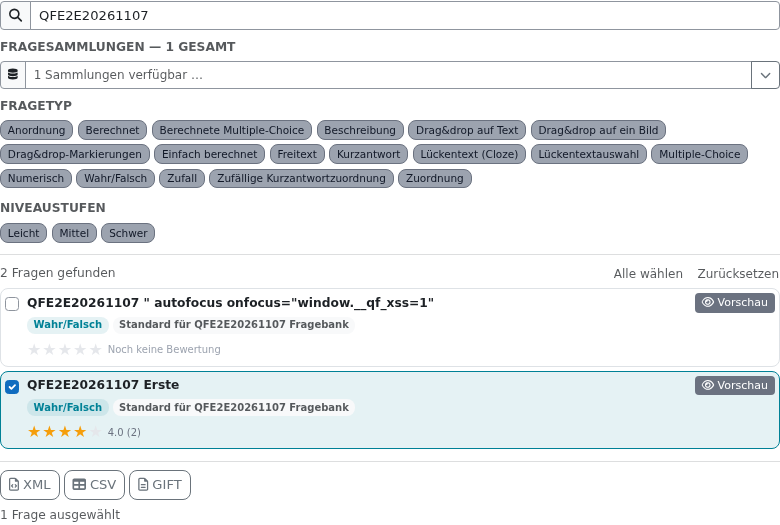
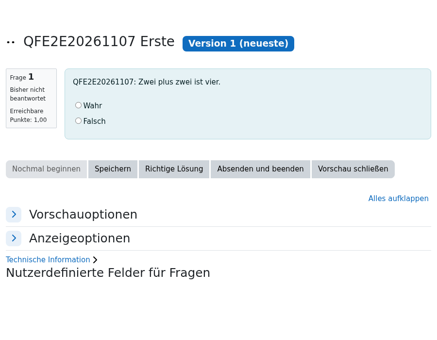

# Fragenfilter: Integration und E2E auf Spike

## Ergebnis

Build **2026110709**, Release **v1.6.0**. Friedhelms `lokaler-stand` (`0de51a9`)
und das Refactoring (`e5beac9`, Spec #20) sind mit Mergecommit `9a4043c` verbunden.
Nachfolgende Review- und E2E-Fixes erhalten die eigenen Fragenfilter-Pool-Konten.
Es gibt keine Laufzeitabhängigkeit von Kursfilter-Klassen. Der Kursfilter-Code
wurde nicht geändert.

```text
Öffentliche Aufgabenpool-Suche
  → POST + Sesskey + sichtbare Frage
  → eigenes fragenfilter_pool-Konto
  → befristete Fragebankrolle im Zielkurs
  → echte Core-Vorschau mit cmid
  → Export für Konto UND Browsersitzung
```

Die Veröffentlichung gilt einheitlich für Suche, Kategorien, vorhandene Fragetypen,
Vorschau, Export und Bewertungen. Reguläre Konten benötigen zusätzlich ihre
Frage-Rechte. Kurs- und Systembereich werden auch für öffentliche Besucher beachtet.

## Ausgeführte Prüfungen

| Prüfung | Ergebnis | Geltungsbereich |
|---|---|---|
| Vollsuite ohne Kursfilter | **104 Tests, 1.201 Assertions**, Exit 0 | Moodle 5.1.8+, PHP 8.3.36, MariaDB 10.11.18, echte HTTP-Anfragen |
| Vollsuite ohne Kursfilter (PostgreSQL) | **104 Tests, 1.201 Assertions**, Exit 0 | Moodle 5.2.4, PHP 8.4.27, PostgreSQL 16.14, echte HTTP-Anfragen |
| Vollsuite mit Kursfilter vor Review-Fixes | **101 Tests, 1.177 Assertions**, Exit 0 | Historischer Zwischenstand 2026110704; kein finaler Koexistenz-Vollsuitebeleg |
| Browser-E2E mit installiertem Kursfilter | **8 Szenarien grün, keine pageErrors** | Echter HTTPS-Aufruf von Spike, Build 2026110709 |
| Upgrade | Beide Ausgangsstände grün | `2026102216` und `2026110703`, eigene Testdatenbank; zusätzlich altes Bewertungsschema |
| Nachinstallation | `phpunit/cli/util.php --buildconfig` Exit 0 ohne Debug-Ausgabe | Isolierte Installation ohne Kursfilter |
| Formatierung | phpcbf/phpcs ohne Befund | Moodle-Standard |
| PHPDoc | Exit 0, keine Warnungen | Offizieller moodle-plugin-ci-Prüfer |
| Pluginstruktur / Savepoints | Beide Exit 0 | 16 passend geordnete Upgrade-Blöcke |
| JavaScript | ESLint und AMD-Rollup erfolgreich | Node 22.23.3, Moodle-Grunt; erzeugte Dateien enthalten |
| Semgrep | **0 ERROR**, Exit 0 | Fixiertes Vereinsimage, 11 ERROR-Regeln, 57 PHP-Dateien |

Die CI-Matrix des finalen PR-Heads wird separat in GitHub ausgewiesen; lokale
MariaDB-Ergebnisse ersetzen den PostgreSQL-/PHP-8.4-Lauf nicht.

Rohbelege, Screenshots und Dateihashes:
[Nachweisverzeichnis](fragenfilter-integration-2026-11-07/).
Der erste Koexistenz-Vollsuitebeleg ist ausdrücklich ein früherer Stand. Die
CI-Nachbesserung zu Build 2026110709 verändert ausschließlich Testaufbau und
Testmessung; die Anwendungslogik bleibt gegenüber Build 2026110708 unverändert.

## CI-Nachbesserung vom 08.11.2026

Der [erste Matrixlauf](https://github.com/Moodle-in-Niedersachsene-V/block_fragenfilter/actions/runs/42415749308)
bestand MariaDB und Semgrep, meldete auf Moodle 5.2/PHP 8.4/PostgreSQL jedoch
elf Testfehler. Zehn betrafen den gemeinsamen HTTP-Anmeldeablauf, einer die
Abfragezählung. Beide Ursachen wurden separat in einer eigenen Testinstallation
reproduziert und behoben:

- Moodle 5.2 deaktiviert Home standardmäßig (`enablemyhome=0`). Die öffentliche
  Hub-Fixture aktiviert Home jetzt explizit. Keine Änderung der globalen
  Website-Konfiguration durch Anwendungscode.
- PostgreSQL verwendet bei `get_recordset_sql()` einen Cursor; `FETCH` und `CLOSE`
  zählen als zusätzliche Roundtrips. Der Tag-Ladetest vergleicht nun eine mit
  drei Fragen und verlangt konstante Kosten. Eine Abfrage pro Ergebnis würde
  weiterhin scheitern.

Die gezielten Gegenfälle und anschließend beide kompletten Suiten bestehen:
**je 104 Tests / 1.201 Assertions** auf MariaDB/PHP 8.3 und PostgreSQL/PHP 8.4.
Die lokale PostgreSQL-Installation verwendet Moodle 5.2.4 und PostgreSQL 16.14;
die CI prüft den dort aktuellen Moodle-5.2-Zweig und PostgreSQL-16-Patchstand. Das [Kurzprotokoll](fragenfilter-integration-2026-11-07/ci-fix-summary.txt)
zeichnet den Rot-/Grün-Nachweis auf. Die finale CI am neuen PR-Head wird von
GitHub separat ausgewiesen.

## Im Browser nachgewiesen

1. Öffentliche Suche im zentralen Seiteninhalt: genau zwei veröffentlichte
   Testfragen, Export zunächst verborgen. Attributfragmente im Fragennamen bleiben
   Text, keine injizierten Attribute und keine Skriptausführung.
2. Direkte private Frage-ID startet keine Pool-Anmeldung.
3. Erste Vorschau zeigt die echte Moodle-Frage mit `cmid`; Suchtext und Auswahl
   bleiben nach Pool-Anmeldung erhalten, Export wird aktiviert.
4. Zweite Vorschau öffnet in derselben Sitzung ebenfalls die echte Frage.
5. XML, CSV und GIFT werden über die Exportbuttons heruntergeladen und enthalten
   die gewählte Frage.
6. Bewertung über den Sternbutton; Secure-/HttpOnly-/SameSite=Lax-Cookie ist für
   JavaScript unsichtbar. Wiederholung ändert weder die erste Bewertung noch Anzahl.
7. Profil-, Einstellungs- und Kennwortseiten leiten Pool-Konten zur Startseite;
   Export einer privaten Frage-ID wird abgewiesen.
8. Ein zweiter Browser hinter derselben IP startet ebenfalls eine funktionierende
   eigene Pool-Vorschau. Der HTTP-Gegenfall prüft zusätzlich zwei belegte Konten
   derselben Adresse.





## Vorherige Fehler und Korrekturen

- Öffentlicher Suchbereich: zwei Aufgabenpool-Kurse wurden auch bei `system`
  geliefert. Kontextgrenze erhalten; Rot-/Grün-Test für alle/Kurs/System.
- Cleanup: alte und aktive Sitzung desselben Kontos führten zum Logout der
  aktiven Sitzung. Gemeinsamer Belegungs-Lock und Prüfung aktiver Sitzungen.
- Rollen: globale Overrides der gemeinsamen Rolle wurden durch eine nur per
  Einschreibung vergebene Fragebankrolle ersetzt. Kein `moodle/course:view`,
  keine Trainer-/Bearbeiterrolle. Gegenfälle für fremdes Konto und nach Abmeldung
  aus dem Kurs sind im Modul-Test enthalten.
- E2E rot: Core-Vorschau landete auf der Kursseite. Der eigenen Fragebankrolle
  fehlte `mod/qbank:view`; genau dieses Leserecht ergänzt, ohne Trainerrechte.
- E2E rot: Nach Pool-Anmeldung wechselten Startseite und Dashboard in einer
  Umleitungsschleife. Der eigene Hook setzt nur für Pool-Anfragen die Startseite;
  die globale Website-Konfiguration bleibt erhalten. HTTP-Regression vorhanden.
- Semgrep kann die zentrale Exportberechtigung in `visitor_access` nicht verfolgen.
  Die lokale Ausnahme am Dateihandler begründet die vorhandenen Login-, Capability-,
  Konto- und Sitzungskontrollen; der unveränderte Regelsatz bleibt aktiv.

## Testaufbau und Reproduktion

Die Devstack-Einrichtung ist getrennt dokumentiert:
[Devstack-PR #21](https://github.com/matthiasgruenwald/moodle-devstack/pull/21).
`local_easyadmin` ist auf allen fünf Instanzen installiert. Auf Spike stehen
Fragenfilter **68** und Kursfilter **61** zentral in `easyadmin-top`. Die vorhandene
Fragenfilter-Instanz **66** in Kurs 6 bleibt erhalten. Nur die Platzierung des
Kursfilters wurde verändert, keine Kursfilter-Funktion geprüft oder geändert.

Fixture auf Spike: Token `QFE2E20261107`, Aufgabenpool-Kurs **53**, privater Kurs
**54**, öffentliche Fragen **1993/1994**, private Frage **1995**, Fragebank-`cmid`
**2091**. Es sind ausschließlich eigens angelegte Testinhalte. Sie bleiben für
Friedhelms Review sichtbar; Browserkontexte melden sich nach dem Test ab.
Keine bestehenden Fragen wurden geändert. Die einmalige Testbewertung gehört
zu einer synthetischen Frage und wird keinem realen Konto fachlich zugeordnet.

Für einen neuen Lauf auf einer anderen dedizierten Testinstanz:

```bash
FRAGENFILTER_E2E_SETUP=1 php public/blocks/fragenfilter/tests/e2e/seed.php > /tmp/qf-fixture.json
FRAGENFILTER_E2E_URL=https://example.test/ \
FRAGENFILTER_E2E_FIXTURE=/tmp/qf-fixture.json \
FRAGENFILTER_E2E_OUTPUT=/tmp/qf-browser-evidence \
node public/blocks/fragenfilter/tests/e2e/fragenfilter.cjs
```

Playwright (`@playwright/test`) und Chromium müssen in der Testumgebung vorhanden
sein. Auf diesem Devstack wurden die vorhandene Installation über `NODE_PATH`
und Chromium über `PLAYWRIGHT_CHROMIUM_EXECUTABLE` verwendet. Es ist keine neue
Laufzeitabhängigkeit des Moodle-Plugins. Die native Browservorschau war für diese
Sitzung nicht freigeschaltet; deshalb erfolgte der Nachweis mit echtem Playwright.

## Grenzen und Rücknahme

Kein Main-Merge und keine Produktionsfreigabe. Reale Hub-Altdaten wurden nicht
migriert; bestehende externe Freigabepunkte im Fallplan bleiben offen. Kein
Lasttest mit gezielt gleichzeitig eintreffenden Requests und kein Cross-Site-Test.
Tag-/Filter-XSS wird durch den Fragennamen-Test nicht pauschal als geprüft gewertet.

Vor den Spike-Upgrades wurden nach der dortigen Dokumentation Snapshots erzeugt,
zuletzt `/opt/moodle-devstack-secrets/dumps/kurspilot-spike-20261107-223845.sql`.
Das Upgrade legt eigene Konten und Rollen an bzw. korrigiert Rollenrechte.
Rücknahme über den passenden Datenbank-Snapshot und vorherigen Pluginstand;
ein bloßer Code-Downgrade ersetzt das nicht.
